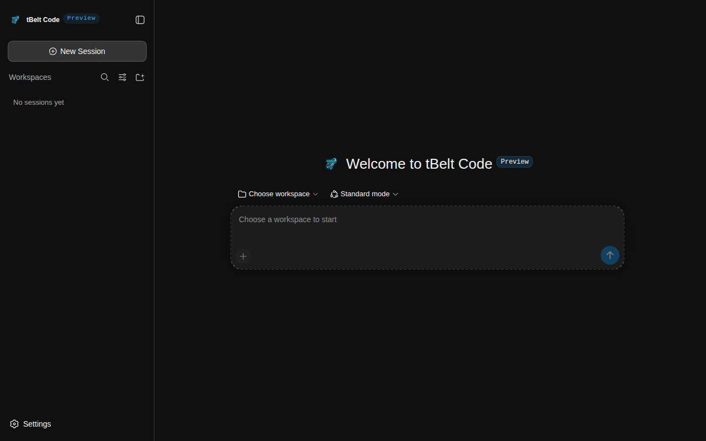

  

<h1 align="center">tBelt Code</h1>

A coding agent for your desktop and your terminal. Any model, sandboxed on your machine.

  
  
  

  <a href="https://code.tbelt.online">Download</a> ·
  <a href="https://code.tbelt.online/changelog">Changelog</a> ·
  <a href="SAFETY.md">Safety</a> ·
  <a href="https://github.com/tBeltty/tbelt-code-public/issues">Issues</a>

  

## Features

- Any provider: hosted APIs with your own key, or local models through Ollama or LM Studio.
- Sandboxed commands with per-session access: Read Only, Workspace Write or Full.
- Several agents in parallel, each in its own git worktree.
- A checkpoint before every edit, restored with `/undo`.
- Plans and line comments in the change review, reviewed before you approve.
- Your own agents as Markdown files, with per-tool permissions.
- A side panel preview for web pages, images and PDFs, where you can point at an element.
- Web search with no account or key, MCP servers, skills and plugins.
- Spend per chat and per month, with limits.
- English, Spanish, Greek and French.

## Desktop and terminal

The app and `dsh terminal` share the same sessions. Install the `tbelt` command from the app on any platform, then run `tbelt` in a project directory.

## Install

Download the installer for your system from [code.tbelt.online](https://code.tbelt.online).

| Platform | Package | Updates |
| --- | --- | --- |
| Windows 10 or 11, x64 | `.exe` | In the app |
| macOS 12 or later, Apple silicon | `.dmg` | Manual |
| Linux x64 | AppImage | In the app |

Builds are not code-signed yet. tBelt Code is a developer preview.

## Changelog

Every release is listed at [code.tbelt.online/changelog](https://code.tbelt.online/changelog).

## Contributing

Open an [issue](https://github.com/tBeltty/tbelt-code-public/issues) for a bug or an idea. Pull requests are not accepted.

## License

Copyright (C) 2026 tBelt. Licensed under the [GNU Affero General Public License v3.0](LICENSE), with an [additional permission](LICENSES/Claude-Agent-SDK-exception.txt) to combine it with the Claude Agent SDK. tBelt Code builds on [DeepSeek Harness](https://github.com/deepseek-ai/deepseek-harness), which keeps its [MIT license](LICENSES/DeepSeek-Harness-MIT.txt). Third-party notices: [THIRD_PARTY_NOTICES.md](THIRD_PARTY_NOTICES.md).
